  

  

  
  
  

  
  

---

## About me

I'm a **Bachelor of Computing (Integrated Honours)** student at **Belgium Campus iTversity** in Pretoria, majoring in **Data Science and Business Intelligence**. I take a project the whole way from raw data to a decision: cleaning and validating data, engineering features, training and **explaining** machine learning models, designing databases and presenting results in dashboards that non-technical people can use.

---

## Tech stack

  

  
  
  
  
  
  
  
  

---

## Featured projects

<table width="100%">
  <tr>
    <td width="50%" valign="top">
      <a href="https://github.com/G-Baloyi/Bank-Transaction-Fraud-Detection-System"><b> Bank Transaction Fraud Detection</b></a> 
      Six-stage pipeline on 200,000 transactions: EDA, feature engineering, model benchmarking, threshold optimisation, SHAP explainability and a risk-scoring dashboard.  
      <code>Python</code> <code>XGBoost</code> <code>SHAP</code> <code>SMOTE</code>
    </td>
    <td width="50%" valign="top">
      <a href="https://github.com/G-Baloyi/Bank-Customer-churn-and-CLV-Prediction"><b> Customer Churn &amp; CLV Prediction</b></a> 
      Predicts churn and customer lifetime value across 50,000 banking records and turns both into a retention priority matrix for the business.  
      <code>Python</code> <code>Scikit-learn</code> <code>SHAP</code> <code>Plotly</code>
    </td>
  </tr>
  <tr>
    <td width="50%" valign="top">
      <a href="https://github.com/G-Baloyi/Customer-Credit-Risk-and-Financial-Behavior-Analysis"><b> Credit Risk &amp; Financial Behaviour</b></a> 
      Joins demographic and transaction data for 1,000 customers and shows the drivers of default in interactive Tableau dashboards.  
      <code>Tableau</code> <code>Excel</code> <code>SQL</code>
    </td>
    <td width="50%" valign="top">
      <a href="https://github.com/G-Baloyi/Superstore_Sales_Forecast"><b> Superstore Sales Forecasting</b></a> 
      Monthly sales forecasting with lag, rolling and cyclic features, comparing Random Forest, Gradient Boosting and Linear Regression.  
      <code>Python</code> <code>Time series</code> <code>Random Forest</code>
    </td>
  </tr>
  <tr>
    <td width="50%" valign="top">
      <a href="https://github.com/G-Baloyi/SoyezJolie-Database-System"><b> Soyez Jolie Database System</b></a> 
      Third normal form SQL Server database with stored procedures, triggers, views, indexes and role-based access control.  
      <code>SQL Server</code> <code>T-SQL</code> <code>3NF</code> <code>RBAC</code>
    </td>
    <td width="50%" valign="top">
      <a href="https://github.com/G-Baloyi/BugTrack_Issue_Tracking_System"><b> BugTrack Issue Tracker</b></a> · <a href="https://g-baloyi.github.io/BugTrack_Issue_Tracking_System/">live demo</a> 
      Responsive issue tracking web app with login, Kanban dashboard, filters, comments and dark mode.  
      <code>JavaScript</code> <code>HTML5</code> <code>CSS3</code>
    </td>
  </tr>
  <tr>
    <td width="50%" valign="top">
      <b> Hospital Record Management System</b> 
      Layered C# application with AES encryption, role-based access control, audit logging, background threads and events.  
      <code>C#</code> <code>.NET</code> <code>OOP</code> <code>AES</code>
    </td>
    <td width="50%" valign="top">
      <a href="https://g-baloyi.github.io/My_Portfolio/"><b> Portfolio website</b></a> 
      Case studies for every project, my experience and my CV in one place. The best next click.  
      <code>HTML</code> <code>CSS</code> <code>JavaScript</code>
    </td>
  </tr>
</table>

---

## Experience and education

| When | What |
|---|---|
| **Jul 2026 – Aug 2026** | **Data Visualization Intern**, Excelerate: cleaned a 5,733-row dataset, built an interactive Tableau dashboard, traced a data-quality anomaly to its source |
| **Apr 2026 – May 2026** | **Project Lead, AI-Powered Data Analysis Internship**, Excelerate: led a cross-functional team of eight |
| **2019 – Present** | **Tutor**: mathematics and sciences tutor |
| **2023 – present** | **Bachelor of Computing (Integrated Honours)**, Belgium Campus iTversity: Data Science and Business Intelligence |

**Certifications:** &nbsp;     

---

## GitHub analytics

  
  

  

  

---

## Let's connect

I'm open to internships, workplace learning placements, and collaborations in data science, business intelligence, and machine learning.

  
  
  

  

  

